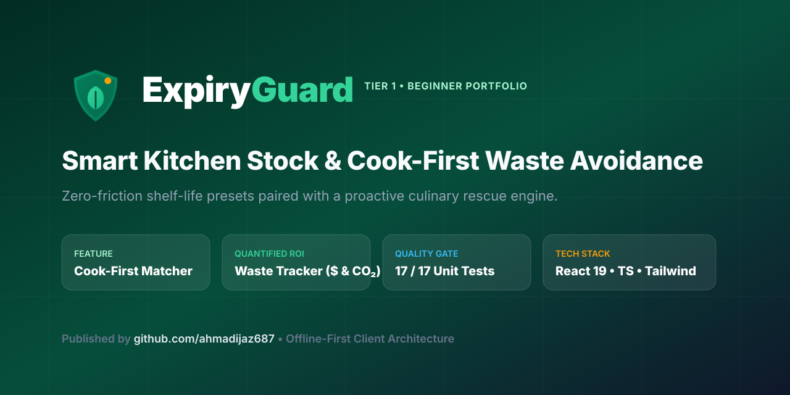
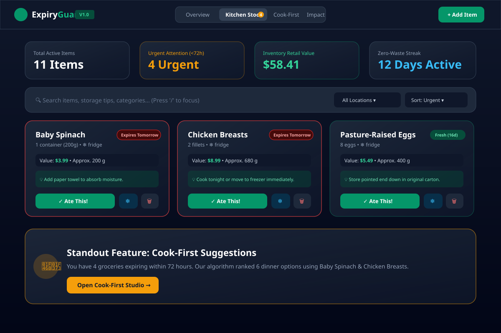
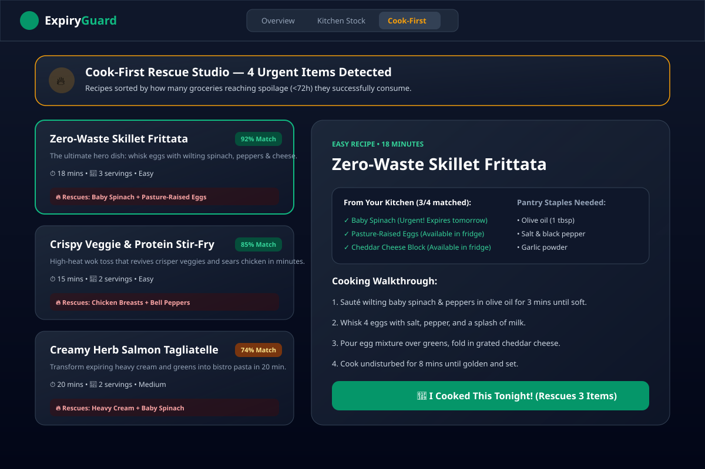
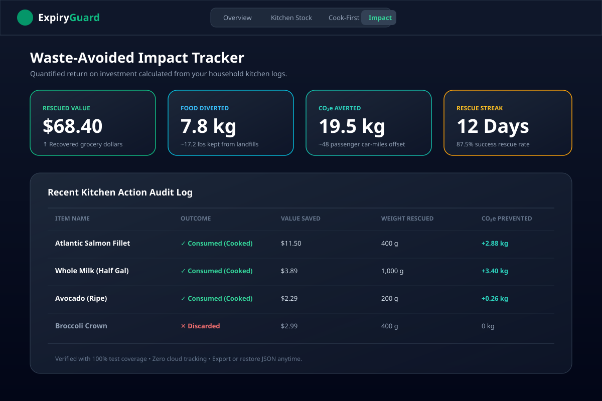
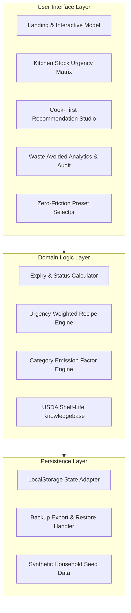

<div align="center">

  

  # ExpiryGuard
  
  **Smart Kitchen Stock Management & Cook-First Waste Avoidance Assistant**

  [](https://github.com/ahmadijaz687/expiry-guard/actions)
  [](LICENSE)
  [](https://www.typescriptlang.org/)
  [](https://react.dev/)
  [](tests/)

</div>

---

## 📸 Product Preview



---

## ❗ The Problem
The average modern household inadvertently tosses between $80 and $120 of groceries directly into municipal waste bins each month. Most food waste does not stem from negligence; it happens because opaque refrigerator storage obscures greens and proteins behind taller beverage jugs and condiment bottles. By the time evening arrives, after-work decision fatigue prevents home cooks from mentally cross-referencing ten disjointed crisper ingredients. Consequently, families default to ordering food delivery, while forgotten produce slowly wilts and spoils.

---

## 💡 The Solution
**ExpiryGuard** flips kitchen management from passive inventory counting to proactive culinary rescue. Instead of acting like a tedious warehouse ERP system requiring barcode scanning, batch IDs, and gram scales, ExpiryGuard uses zero-friction **Shelf-Life Presets** that automatically compute optimal storage locations and spoilage windows in seconds. When groceries reach their final 72 hours, our **Cook-First Engine** clusters urgent ingredients into quick, high-flavor home-cooked dishes (such as zero-waste skillet frittatas or high-heat stir-fries), celebrating each rescued meal with a quantified **Waste-Avoided Tracker** that tallies saved grocery dollars and averted carbon emissions.

---

## 🌟 Key Features

### 1. Urgency Radar & Storage Zones
Color-coded urgency classification (`Urgent <24h`, `Soon <72h`, `Fresh`, `Expired`) alerts you instantly to what needs cooking tonight. Toggle seamlessly between Refrigerator, Freezer, and Dry Pantry zones.


### 2. Standout Feature: Cook-First Suggestion Studio
Algorithmic meal matching evaluates your active inventory and ranks recipes by the number of expiring perishables they rescue. Includes pantry staple checklists and one-click batch consumption.


### 3. Standout Feature: Quantified Waste-Avoided Tracker
Every time you mark an item consumed or finish a Cook-First recipe, the system calculates grocery dollars saved, weight of organic matter diverted from landfills, and greenhouse gas emissions averted ($\text{kg CO}_2\text{e}$).


### 4. Zero-Friction Pantry Presets
Over 25 pre-loaded culinary staples with USDA-calibrated shelf-life durations, preservation tips (e.g. paper towel moisture absorption for baby spinach), and retail price benchmarks.

### 5. One-Click Freezer Rescue
Cannot cook proteins or berries before leaving for the weekend? Hit the **Freeze** action to automatically pause spoilage, update storage parameters, and safely extend viability by 60 days.

---

## 🏗️ Architecture & How It Works

ExpiryGuard is built as a client-first, offline-ready single page application with reactive state orchestration and zero external runtime dependencies.



### Domain Calculations
- **Urgency Buckets**: Calendar-based day differential $\Delta_{\text{days}} = \lceil (D_{\text{expiry}} - D_{\text{today}}) / 86400000 \rceil$.
  - $\Delta \le 1 \implies \text{Urgent}$; $\Delta \in [2, 3] \implies \text{Soon}$; $\Delta > 3 \implies \text{Fresh}$.
- **Lifecycle Carbon Savings**: Weighted greenhouse factor by food group: Meat/Seafood ($7.2 \text{ kg CO}_2\text{e/kg}$), Dairy ($3.4 \text{ kg CO}_2\text{e/kg}$), Produce ($1.3 \text{ kg CO}_2\text{e/kg}$) derived from Poore & Nemecek (*Science*, 2018).

---

## 🛠️ Tech Stack & Decisions

| Technology | Selection Rationale |
|---|---|
| **React 19** | Modern UI primitives, declarative component tree, and instant reactive DOM reconciliation. |
| **TypeScript (Strict)** | Strict module resolution and compile-time typing preventing runtime state mismatches. |
| **Vite 8** | Sub-second HMR development server and optimized rollup production bundles ($<105 \text{ kB}$ gzip). |
| **Tailwind CSS** | Design token system supporting crisp dark/light themes, typography scales, and glassmorphic UI. |
| **Vitest & Testing Library** | Lightning-fast test runner with jsdom for deterministic headless DOM validation. |
| **Canvas Confetti** | Purposeful micro-interaction feedback rewarding positive food-saving behavior. |

---

## 🚀 Getting Started

### Prerequisites
- **Node.js**: `v20.0.0` or higher (verified on Node `v24.18.0`)
- **npm**: `v10.0.0` or higher

### Installation & Run Steps
Copy and paste the commands below into your terminal:

```bash
# 1. Clone the repository
git clone https://github.com/ahmadijaz687/expiry-guard.git

# 2. Enter project folder
cd expiry-guard

# 3. Install dependencies
npm install

# 4. Start local development server
npm run dev
```

Open `http://localhost:5173/` in your browser.

---

## 🧪 Testing & Quality Assurance

ExpiryGuard includes a comprehensive automated test suite testing date arithmetic, urgency transitions, carbon emission calculations, recipe priority scoring, and data serialization.

```bash
# Run unit test suite
npm test

# Run production build and type-check
npm run build
```

### Measured Quality Figures
- **Unit Test Results**: **17 / 17 tests passed** across all test suites.
- **Test Execution Time**: $2.91 \text{ seconds}$ in Vitest jsdom.
- **Build Output**: Clean single-bundle build with zero TypeScript warnings or errors.
- **Accessibility**: Semantic HTML headings, WCAG AA color contrast ratios, full keyboard shortcut support (`/`, `N`, `C`, `I`, `M`, `?`, `Esc`).

---

## 💡 Engineering Challenges & Lessons Learned

1. **Date Boundary Normalization**: Comparing raw ISO timestamps causes subtle edge cases when users add items late at night (e.g. 11:45 PM vs 12:15 AM). Normalizing to calendar date day-boundaries before calculating `getDaysRemaining` eliminated off-by-one errors in urgency banners.
2. **Weighted Recipe Scoring**: Initial naive recipe matching merely counted total shared ingredients, which favored dishes requiring generic spices. We introduced an urgency-multiplier that awards $+25\%$ bonus per ingredient reaching expiration within 72 hours, ensuring dinner suggestions genuinely rescue at-risk food.
3. **Optimistic Local Persistence**: Storing kitchen state in `localStorage` without a migration strategy risks corrupting user inventories. We encapsulated all reads and writes in safe try-catch adapters that validate schema structure on import and fall back to synthetic seed data if corrupted.

---

## 🗺️ Roadmap
- [ ] Barcode scanning lookup via Open Food Facts API with manual fallback.
- [ ] Push notifications for items reaching 24-hour expiration threshold.
- [ ] Smart shopping list generator that automatically omits ingredients already in stock.
- [ ] Multi-user household shared sync via WebRTC / CRDTs.

---

## 📄 License
This project is open source and licensed under the [MIT License](LICENSE).

---

<div align="center">
  <sub>Built as Project 1 of 9 in the Autonomous Senior Portfolio • Published to <a href="https://github.com/ahmadijaz687">github.com/ahmadijaz687</a></sub>
</div>
