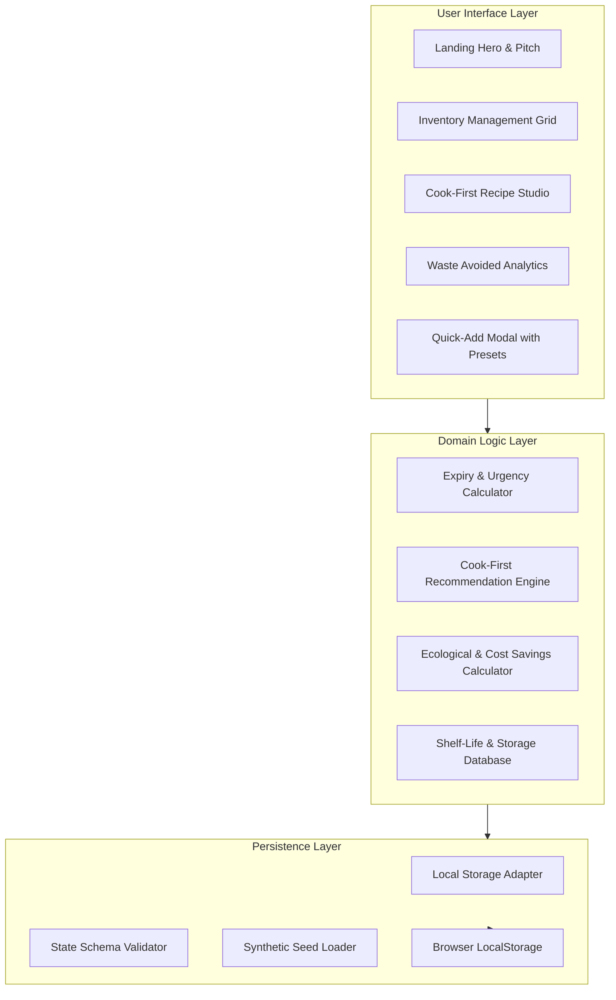

# Architecture Document: ExpiryGuard

## 1. System Overview
**ExpiryGuard** is an offline-first single-page web application engineered with React, TypeScript, and Tailwind CSS. The system maintains an event-driven client state layer backed by persistent browser storage.



---

## 2. Component Hierarchy
- `App.tsx`: Main routing and top-level layout controller.
  - `Navbar.tsx`: Brand logo, navigation tabs (Landing, Inventory, Cook-First, Impact), theme switcher (dark/light), quick-add button.
  - `LandingPage.tsx`: Product landing page, feature highlights, problem-solution breakdown, interactive calculator preview.
  - `InventoryView.tsx`:
    - `StatSummaryBar.tsx`: Summary counters (Total items, expiring in 48h, savings to date).
    - `FilterSortToolbar.tsx`: Search bar, category chips, storage location filter (Fridge, Freezer, Pantry), sort dropdown.
    - `InventoryGrid.tsx`: Responsive card grid featuring urgency indicators, days remaining, storage tips, and instant actions (Consume, Freeze, Discard, Edit).
  - `CookFirstView.tsx`:
    - `UrgentAlertBanner.tsx`: Highlights items expiring within 72 hours.
    - `RecipeSuggestionCard.tsx`: Match percentage, key expiring ingredients used, pantry staples needed, step-by-step instructions, and "Cooked This!" one-click consumption.
  - `ImpactView.tsx`:
    - `MetricCards.tsx`: $ Saved, kg Food Diverted, kg CO₂e Prevented, Streak days.
    - `ImpactBreakdown.tsx`: Monthly savings breakdown and category waste diversion distribution.
    - `DataManagement.tsx`: Export JSON, import JSON, reset to synthetic seed data.
  - `AddItemModal.tsx`:
    - Instant preset selector (25+ common groceries with automatic shelf life and storage recommendations).
    - Custom manual entry with category, quantity, unit, storage location, purchase date, and expiry date.

---

## 3. Data Model Schema

```typescript
export type StorageLocation = 'fridge' | 'freezer' | 'pantry';

export type FoodCategory =
  | 'produce'
  | 'dairy_eggs'
  | 'meat_seafood'
  | 'bakery'
  | 'pantry'
  | 'beverages'
  | 'frozen'
  | 'leftovers';

export type UrgencyStatus = 'urgent' | 'soon' | 'fresh' | 'expired';

export interface FoodItem {
  id: string;
  name: string;
  category: FoodCategory;
  location: StorageLocation;
  quantity: number;
  unit: string;
  addedDate: string; // ISO 8601 YYYY-MM-DD
  expiryDate: string; // ISO 8601 YYYY-MM-DD
  estimatedCost: number; // in USD
  storageTip?: string;
  status: 'active' | 'consumed' | 'discarded';
  consumedDate?: string;
}

export interface WasteRecord {
  id: string;
  itemId: string;
  name: string;
  category: FoodCategory;
  action: 'consumed' | 'discarded';
  cost: number;
  weightGrams: number;
  co2SavedKg: number;
  date: string;
}

export interface UserStats {
  totalDollarsSaved: number;
  totalKgRescued: number;
  totalCo2SavedKg: number;
  itemsConsumedCount: number;
  itemsDiscardedCount: number;
  consecutiveStreakDays: number;
}
```

---

## 4. Algorithmic Specifications

### Expiry Urgency Formula
Given $D_{\text{today}}$ and $D_{\text{expiry}}$:
$$\Delta_{\text{days}} = \lceil (D_{\text{expiry}} - D_{\text{today}}) / 86400000 \rceil$$

- $\Delta_{\text{days}} < 0 \implies \text{expired}$
- $0 \le \Delta_{\text{days}} \le 1 \implies \text{urgent} \ (\le 24\text{ hours})$
- $2 \le \Delta_{\text{days}} \le 3 \implies \text{soon} \ (\le 72\text{ hours})$
- $\Delta_{\text{days}} > 3 \implies \text{fresh}$

### Ecological & Cost Impact
Based on FAO and USDA food waste environmental impact studies:
- Average food loss carbon footprint: $\approx 2.5 \text{ kg CO}_2\text{e}$ per kg food.
- Food categories assign weighted emissions (e.g. Meat: $7.0 \text{ kg CO}_2\text{e/kg}$, Dairy: $3.2 \text{ kg CO}_2\text{e/kg}$, Produce: $1.2 \text{ kg CO}_2\text{e/kg}$).
